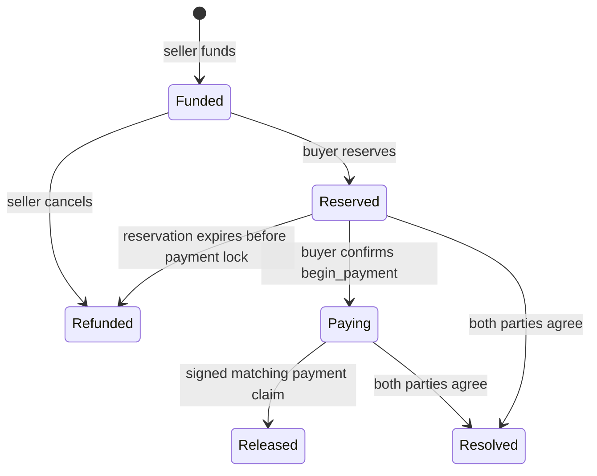

# Pactlane escrow

Local contract baseline for one seller-funded offer and one buyer, using a configured SEP-41 token and an immutable Ed25519 payment-policy signer. The current terms support EUR/Revolut only. This has passed synthetic native and WASM tests; it has not been deployed, audited or connected to an authenticated payment proof.

The contract authenticates the configured signer's claim. The signer remains responsible for verifying the bank source, completed outgoing payment, recipient, exact amount/currency, payment timestamp and stable payment ID. Neither a browser callback nor TLSNotary setup is sufficient to issue a claim.

## App integration

The machine-readable contract spec is [interface.json](interface.json). All times are Unix seconds; IDs are `u64`; monetary values are positive `i128` integers. Use `bigint` or decimal strings in JavaScript, never floating point. Token amounts use the configured token's base units; EUR amounts use cents. Recipient commitments and nullifiers are 32 bytes.

| Method                            | Authorization                                               | Result / behavior                                                            |
| --------------------------------- | ----------------------------------------------------------- | ---------------------------------------------------------------------------- |
| `get_config()`                    | Anyone                                                      | Immutable token address and payment-policy signing key                       |
| `fund(terms)`                     | Seller, including the nested token transfer                 | Transfers the exact token amount into escrow and returns a new order ID      |
| `get_order(order_id)`             | Anyone                                                      | Terms, buyer, state, reservation time, payment deadline and lock time        |
| `reserve(order_id, buyer)`        | Buyer                                                       | Reserves a funded offer; seller cannot cancel before the reservation expires |
| `begin_payment(order_id)`         | Reserved buyer                                              | Locks escrow before fiat is sent; must confirm before `pay_by`               |
| `release(claim, signature)`       | Any relayer with a valid policy signature                   | Pays the recorded buyer once and atomically consumes the payment nullifier   |
| `refund(order_id)`                | Seller for `Funded`; anyone for an expired `Reserved` order | Returns the full amount to the recorded seller                               |
| `resolve(order_id, buyer_tokens)` | Both seller and buyer, approving the same call              | Splits a reserved or paying order; remainder returns to seller               |
| `claim_digest(claim)`             | Anyone                                                      | Returns the canonical digest; does not validate or approve payment           |
| `payment_used(nullifier)`         | Anyone                                                      | Whether this deployment has consumed the payment                             |

Offers expire within seven days of funding. Reservations last at most one hour and cannot exceed the offer expiry. An order is never re-reserved or recycled. `OrderChanged` events contain `order_id` and the resulting state; fetch `get_order` for details.



**The app must wait for `begin_payment` to confirm before instructing the buyer to send fiat.** A `Reserved` order can expire into a seller refund. A `Paying` order cannot. Paying before this lock is confirmed is outside the contract's protection.

Recovery policy approved by Vijay on 25 October 2026 for the first escrow: if payment proof is unavailable after the payment lock, hold funds until both parties authorize a full refund, release or split. A later valid payment-policy claim can still release the order. This permits a buyer to lock funds indefinitely and requires both wallets to remain available. There is no arbitrator, forced timeout, admin withdrawal, signer rotation or upgrade entry point. Approval covers this first-version recovery policy; it does not establish production readiness.

## Claim and signature

`PaymentClaim` binds the order ID, seller, buyer, token, token amount, exact fiat amount/currency, rail, recipient commitment, reservation time, payment deadline, payment timestamp, claim expiry and stable payment nullifier. See the Rust type and generated spec for exact field names/types.

The signature message is the raw 32-byte result of:

```text
SHA256(ScVal-XDR([
  Symbol("PACTLANE_PAYMENT_V1"),
  Bytes(SHA256(network_passphrase)),
  Address(current_contract),
  PaymentClaim
]))
```

This is the SDK's `ToXdr` encoding of the tuple, including the outer `ScVal` vector. A Rust `#[contracttype]` struct is encoded as a symbol-keyed `ScVal` map in canonical key order. `i128`, `u64`, address and byte values must keep their XDR types. Sign the digest bytes with Ed25519, rather than their hex/base64 text. The signature is 64 raw bytes. The signer must independently construct this payload from verified payment data and the on-chain order; accepting a client-supplied digest would bypass payment policy.

The payment timestamp must be at or after the payment lock, strictly before `pay_by`, and no later than the current ledger time. A claim must expire strictly after the current ledger time. Proof generation may finish after `pay_by`: an in-window payment can still release a `Paying` order using a fresh, valid claim.

The frozen [protocol v1 specification](PROTOCOL.md) defines exact domain-separated recipient commitments, account-scoped payment nullifiers and canonical claim XDR. The JS reference and public synthetic vectors are in [protocol/](protocol/). A payment nullifier depends on the verified rail/account/payment identity, never on the order ID. Contract-level replay protection covers this deployment only. A policy service serving multiple escrow deployments must also prevent reuse across deployments. Hashes do not by themselves make bank activity anonymous.

Mutual resolution has no payment claim and consumes no nullifier. If parties resolve an actual payment manually, the policy service must record that payment as consumed before considering it for another order. This reconciliation is part of the outstanding signer integration.

## Storage and operations

Orders and used-payment markers use persistent storage. Do not move replay markers to temporary storage or delete them when pruning orders. Archived persistent entries must be restored, which prevents a missing expired marker from becoming an unused payment. Calls renew the instance/code and accessed entries for up to 120,960 ledgers; this is rent maintenance, not the business timeout. A future deployment needs a restoration/maintenance flow, especially for indefinitely held orders. See the SDK's [storage semantics](https://docs.rs/soroban-sdk/29.0.1/soroban_sdk/storage/struct.Storage.html).

The configured token must be a trusted standard token, such as the intended USDC Stellar Asset Contract. Token issuer freezes/clawbacks remain outside escrow control. Tests exercise transfer failures using a synthetic Stellar Asset Contract with revocable authorization.

## Build and check

Use an existing compatible Rust toolchain, `wasm32v1-none` target and Stellar CLI. This run used Rust 1.99.1, Stellar CLI 28.1.0 and SDK 29.0.1. The dependencies are locked; no toolchain installation is performed by this repo.

```sh
cargo test --locked --manifest-path contracts/escrow/Cargo.toml
stellar contract build --locked --manifest-path contracts/escrow/Cargo.toml
PACTLANE_ESCROW_WASM="$PWD/contracts/escrow/target/wasm32v1-none/release/pactlane_escrow.wasm" \
  cargo test --locked --manifest-path contracts/escrow/Cargo.toml
stellar contract info interface \
  --wasm contracts/escrow/target/wasm32v1-none/release/pactlane_escrow.wasm \
  --output json-formatted > contracts/escrow/interface.json
```

`PACTLANE_ESCROW_WASM` makes the same tests register and invoke the actual built WASM rather than the native Rust implementation. All test identities, signing keys and amounts are synthetic. Default host execution limits remain enabled. Build output stays in ignored `target/`.

Prepare and verify the scoped JS protocol package without changing root dependencies:

```sh
npm --prefix contracts/escrow/protocol ci --ignore-scripts
npm --prefix contracts/escrow/protocol test
```

Policy code can import `recipientCommitment`, `paymentNullifier` and `claimDigest` directly from `contracts/escrow/protocol/protocol.mjs` after preparing those dependencies, or vendor the frozen implementation with its pinned SDK and hashes. Each function returns raw bytes in a Node `Buffer`. The release integrator owns any additions to the root package scripts. `npm --prefix contracts/escrow/protocol run vectors:generate` explicitly regenerates fixtures; normal tests never rewrite them.

The checked-in [WASM artifact](artifacts/pactlane_escrow.wasm) is the same optimized binary tested in WASM mode. [Deployment candidate parameters](artifacts/deployment-candidate.json) contain the exact hashes and unresolved configuration; the public fixture key is deliberately absent from that template. No deployment has been attempted. Live testnet protocol compatibility could not be checked from this restricted network and remains a deployment prerequisite.

Tests cover funding and conservation, real authorization rejection with mocking disabled, exact dual-wallet settlement authorization, time boundaries, term mismatches, wrong signers, signature mutation, cross-network/contract/order replay, duplicate payment claims, and rollback of deposits, releases and split settlements when token transfers fail. The 29 contract scenarios run in both native and WASM modes, including byte-for-byte shared XDR/digest/signature compatibility and release of the frozen JS-signed EUR 20 / 22 USDC whole offer. The scoped JS suite has 11 tests, including integer boundaries above JavaScript's safe-number range. Live RPC integration, a production signing service and external review remain outstanding.
