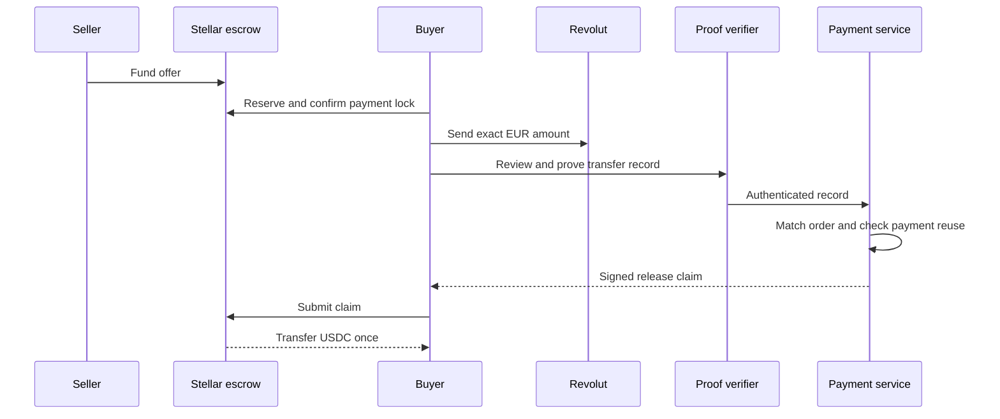

# How Pactlane works

Pactlane connects a bank payment to a Stellar escrow. Each part has one job: the bank records the payment, TLSNotary authenticates the response, the payment service matches it to the trade, and the contract moves the tokens.

## A funded offer comes first

The seller commits the token amount, EUR price, payment recipient and expiry. Funding transfers tokens into escrow. The marketplace reads confirmed funded orders; a draft or pending deposit is kept in the seller workspace.

A buyer reserves one whole offer. The `begin_payment` transaction locks it before the recipient and payment instructions are shown. This matters because a reservation can expire back to the seller, while a payment-locked order stays held during verification.

## The payment is checked against the order

The accepted Revolut response identifies the transfer, payer and recipient, completed outgoing state, currency, amount and completion time. EUR is handled as integer cents: an outgoing amount of `-500` is a EUR5.00 debit. Completion milliseconds are converted under the documented time rule; payment must fall inside the locked order’s window.

The policy reads the order and evidence through server adapters. It checks the private recipient commitment, the approved payer binding and whether the payment identity has already been used. It reserves that identity durably before asking the signer to authorize release.

## The contract checks the claim

The signed claim binds network, contract, order, buyer, seller, asset, amounts, recipient and time. The contract checks its configured signer and consumes the payment’s one-use identifier atomically with the token transfer. That identifier is called a _nullifier_.

## Trust model

The contract trusts the operator’s payment signer to interpret authenticated evidence correctly. It enforces the stored trade terms independently. The verifier sees the disclosed transfer response; Revolut sees the payment; Stellar transactions are public.

After payment locks, a failed proof leaves tokens held. A later valid proof can complete the trade, or both wallets can agree to a release, refund or split. There is no unilateral post-lock timeout refund.

## Read the relevant layer

- [System map](architecture/system-map.md): source files and responsibilities.
- [Escrow](architecture/escrow-contract.md): states, authorization and token movement.
- [Policy](architecture/policy-and-claims.md): signatures, replay and recovery.
- [Bank evidence](architecture/tlsnotary-evidence.md): parsing and payment meaning.
- [Data and privacy](architecture/privacy-and-data.md): who sees what.
- [Operations](architecture/operations-and-readiness.md): deployment and durable state.

[Verification](verification.md) links the completed Revolut-to-USDC mainnet trade and the separate testnet recovery results.
