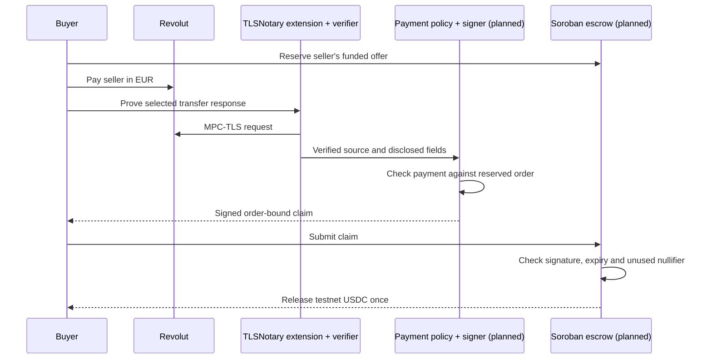

# Architecture

The prototype currently runs a browser launcher and an independently operated TLSNotary verifier. The payment-policy service and escrow below are proposed.

## What the code does today

`tlsn/launcher.mjs` serves the test pages and forwards a fixed set of routes to a loopback verifier. It inserts the configured HTTPS origin into the plugins. It accepts no arbitrary proxy target; the bank target is `app.revolut.com`.

`tlsn/revolut.plugin.mjs` watches for an individual transfer-detail GET and waits for an explicit click. Its authentication-header allowlist is kept inside the extension. The request uses a 4 KiB sent / 16 KiB received budget. The plugin either requests selected payment fields or runs a smaller response-shape check. It returns sanitized diagnostics and always leaves the release gate at `NOT_CLEARED`.

`tlsn/extension-check.plugin.mjs` proves only a fixed public `GET /robots.txt` response, without account credentials. `setup-check.worker.mjs` measures MPC setup without sending a bank request. These checks help locate failures; they do not establish a payment.

## Trust model

TLSNotary’s verifier authenticates the TLS server and checks the protocol transcript. The planned policy service must then interpret the disclosed payment data. A valid transcript alone says nothing about whether this order has been paid.

The Soroban contract would verify a claim signed by a configured operator. That operator is trusted to apply the payment rules correctly and protect its signing key. The contract would not independently verify the full MPC-TLS transcript. Selective disclosure also does not hide activity from the bank or make Stellar settlement private.

The gateway is intended for a private network. Its route restrictions and browser origin pinning are not a substitute for access control. Keep it behind the private HTTPS route; do not expose the upstream verifier or turn it into a public service.

## Proposed release claim

Choose a canonical encoding before implementing the signer. Both sides must hash exactly the same bytes. The claim should bind:

| Field                                     | Purpose                                         |
| ----------------------------------------- | ----------------------------------------------- |
| Version, network and contract             | Prevent reuse across formats and deployments    |
| Order ID and buyer wallet                 | Identify the trade and release destination      |
| Payment rail and recipient commitment     | Match the seller’s payment destination          |
| Fiat amount in minor units and currency   | Match the agreed EUR payment exactly            |
| Token, token amount and seller            | Match the funded escrow                         |
| Stable payment nullifier                  | Prevent the same rail/payment ID settling twice |
| Payment time, reservation time and expiry | Reject older or expired evidence                |

The policy must establish HTTP success, the exact source endpoint, a completed outgoing transfer, the intended recipient, amount, currency and a stable payment ID. It must check field structure and context on the server. The browser’s `fieldsPresent` result is untrusted UI feedback.

Payment IDs need not be posted in plaintext. Decide on a domain-separated nullifier scheme and its privacy limits before deployment. A hash alone does not guarantee anonymity.

## Contract work still needed

Implement escrow funding, reservation, signature authorization, one-use nullifiers, expiry and a payment-failure/dispute policy. Release and nullifier consumption must happen atomically. Include negative cases for the wrong order, buyer, network, recipient, amount, signer, expiry and reused payment.

The archived contract only recovers a signer from an older claim format. It has no payment policy, escrow or replay protection and cannot accept TLSNotary results as written.
