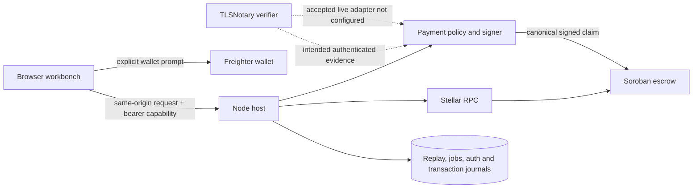

# Architecture at a glance

For the illustrated version, start with the [standalone architecture study](architecture/study.html). It is self-contained, works without a network connection, and links to the editable focused guides.

Pactlane has three different things that should not be conflated: a **public synthetic app**, a **local integration prototype**, and a **passed disposable testnet rehearsal**. The public `https://pactlane.io` audit records source revision `88ba889` and manifest SHA-256 `57976a8918229887b98629139bf2f94ed729bad6acf2181b3f51b8fd886ebebe`. It was not changed by the local host work.

The public app does not connect to these host services. Its wallets, payment checks, and receipts are simulated. The local host source has bearer capability and origin/host checks, an in-memory browser wallet bridge, private offer reader, deployment verifier, testnet chain readers/indexer, and durable policy and transaction storage. The optional policy signing key is not required to start the host; without the signer and trusted verifier adapters, payment authorization remains closed.

## Payment and contract boundary

The intended payment path uses TLSNotary to authenticate selected server-response bytes. The policy operator interprets the disclosed fields against the locked order, private recipient data, timing, and replay registry, then signs the canonical claim. Soroban verifies that configured key's signature and the contract's order bounds. It does not verify TLSNotary or the bank transfer itself.

The example is €20 for 22 tokens: `fiat_minor = 2000` euro cents and `token_amount = 220000000` atoms at seven decimals. Those are synthetic terms. The payment nullifier combines the frozen source namespace, payer scope, and stable transfer identifier. Contract storage prevents reuse within that deployment; the operator-wide replay registry and chain reconciliation matter across service instances and deployments.

The live normalizer deliberately throws `TLSN_PAYMENT_SCHEMA_UNVERIFIED`. No authenticated payment has been accepted. The contract and policy source cannot make that missing evidence schema true by themselves.

## Recovery and execution

The source now implements `resolve(orderId, buyerTokens)` as a joint authorization. The seller signs the exact Soroban authorization entry; the buyer signs the final transaction envelope. The host checks the operation and signatures, and the adapter journals/reconciles the submitted hash and confirmed receipt. A failed or unknown submission is not treated as proof of failure.

A disposable testnet rehearsal passed on 25 October 2026 using the reviewed WASM, PLTEST, synthetic evidence, and disposable programmatic keys. It released 220,000,000 atoms, rejected replay, and split another order 110,000,000/110,000,000. It did not exercise Freighter UI, real USDC, or a bank transfer. See the [sanitized evidence](../evidence/release/testnet-rehearsal-2026-10-25.json).

## Trust and privacy

TLSNotary transcript authentication is not the same as on-chain verification. The operator sees evidence fields and can misuse the policy signing key. The bank sees the customer and payment, the counterparty sees the payment details, and Stellar publishes wallet addresses and token movements. The prototype does not provide anonymity or privacy from those parties.

The verifier privacy patch changes source logging and rejects Proxy commitment mode before opening a proxy target. `cargo check --offline` passed, but the patched verifier was not release-built, deployed, or runtime-retested. It does not establish safe logging for an existing service.

For the details, see the [escrow lifecycle](architecture/escrow-contract.md), [policy and nullifier rules](architecture/policy-and-claims.md), [TLSNotary trust boundary](architecture/tlsnotary-evidence.md), [data handling](architecture/privacy-and-data.md), and [operations/readiness guide](architecture/operations-and-readiness.md).
