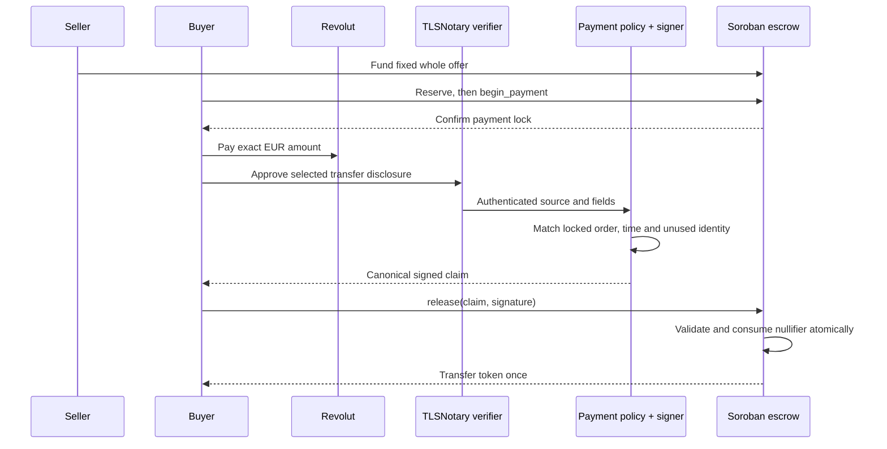

# Architecture

Pactlane has four boundaries: the browser, bank-proof verifier, payment-policy signer and Soroban escrow. A browser progress callback cannot replace a server or chain check.

The local WASM rehearsal runs order, policy and escrow together with synthetic evidence. The browser demo is separate; live proof ingestion rejects unverified records.

## Contract and claim

`contracts/escrow/` implements funding, reservation, payment lock, signed release, pre-lock expiry refund and mutual resolution. One funded offer has one fixed amount and one buyer. It is never partially filled or recycled.

The frozen [protocol](../contracts/escrow/PROTOCOL.md) is `pactlane.protocol.v1`. It uses canonical ScVal-XDR, lexical map keys, exact integer widths and Ed25519. Claims bind network, contract, order, buyer, seller, token/amount, EUR minor units, rail, recipient commitment, payment nullifier and time bounds. JS, policy and Rust share exact vectors.

The recipient commitment binds provider-issued destination identity and private offer salt. The observed destination must independently come from verified evidence; expected seller configuration cannot replace it. The nullifier binds source namespace, verified payer scope and stable transfer ID, independently of order/network/deployment. Cross-deployment replay prevention also needs the durable policy registry and complete chain reconciliation.

## Policy and storage

The public policy method accepts only `{orderId,evidenceId}`. Trusted host readers supply evidence, chain snapshot and private offer data. Policy checks exact completed outgoing payment semantics and confirmed locked-order terms.

Disk SQLite reserves payment identity before signing. Restart, signing failure, expired claims and uncertain delivery never free it automatically. Complete confirmed manual-recovery manifests consume associated payments even when tokens were refunded or split. Unknown manual resolution holds signing until reconciliation.

Synthetic stores and public fixture keys are separated from live bootstrap. `normalizeLiveTlsnPayment` rejects until the real schema is established. Synthetic fixtures do not define real bank semantics.

## Wallet and RPC

`integration/stellar-rpc-adapter.mjs` is a testnet-only Node service candidate matching [the app interface](../app/live-adapter.d.ts). It validates network/configuration, prepares capped-fee transactions, checks the unchanged wallet-signed envelope, persists its hash before submission and reconciles RPC success. A disk journal reserves each action atomically across concurrent instances. Unknown outcomes remain blocked across restart.

Instructions require a confirmed `Paying` order and independently bound destination. Release requires trusted non-synthetic authorization and a canonical signature. Receipts require the exact contract/order transaction and matching token-transfer events.

Authenticated HTTP transport, consistent chain reads, atomic event reconciliation and buyer-envelope/seller-Soroban recovery are implemented as Node modules; see [live service continuation](release/live-services.md). The separate live browser, Freighter client and host composition are also implemented. Authenticated seller approval transport is implemented with one-use claims and exact preimage signatures, followed by the buyer envelope. Approved deployment/private offer/policy configuration remains. `resolve` requires the configured seller authorization port and never submits unilateral recovery.

## Recovery and deadlines

An expired unlocked reservation can refund the seller. After `begin_payment`, proof failure holds funds. A payment made before `pay_by` may be verified later; after that deadline the app stops showing instructions for a new payment.

Both parties may authorize the same release, refund or split. A later valid signed claim may release a held order. There is no arbitrator or hidden admin path; either party can keep funds locked by refusing to cooperate.

## Trust model

TLSNotary authenticates the server and transcript. The operator-run policy interprets disclosed fields and signs the order claim. The contract trusts its configured key and does not verify the full TLS transcript. A compromised or incorrect operator can authorize an incorrect claim within the contract’s bounds.

Selective disclosure does not hide the payment from Revolut or make Stellar settlement private. Credentials, raw transcripts, private salts and signing keys belong outside Git. The earlier `tlsn/` launcher pins routes/origin but provides no public-service authentication. The cloud snapshot is under `tlsn/benchmark/` and `infra/proof-benchmark/`, with explicit pinned origins and bounded public admission. Product domains do not change the frozen bank source namespace. Custom proof-origin configuration is prepared but disabled until root verifies DNS/certificate and derived transports.
