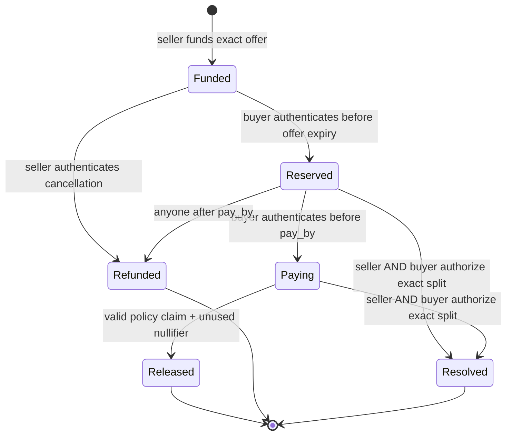

# Escrow contract and lifecycle

The Soroban contract is the token custody and order-state component. It is deliberately narrow: one seller-funded offer can become at most one whole trade with one buyer. It has no partial fills, admin withdrawal, upgrade entry point, unilateral recovery override, or timeout from the `Paying` state.

## State machine

`Reserved` is a short reservation, not a bank-payment lock. `begin_payment` is the buyer's on-chain declaration that they are about to pay; the app must wait for confirmation before showing private payment instructions. Once the contract reaches `Paying`, funds remain held until a valid signed release or mutual resolution. Expiry of `pay_by` or a policy signature does not let the seller reclaim a `Paying` order.

## Stored terms and configuration

Constructor configuration stores the token contract address and 32-byte Ed25519 policy public key. It is immutable after construction. An order stores seller, token amount, fiat minor amount, currency, rail, recipient commitment, offer expiry, reservation duration, current state, optional buyer, reservation time, payment deadline, and payment-lock time. It does not store bank identifiers or the recipient salt.

Order IDs increment and are not recycled. Terms are fixed at funding; a single offer cannot serve another buyer after resolution, release, or refund.

## Methods, callers, and checks

| Method                         | Caller authorization                                  | Main behavior and constraints                                                                                                                                                                                                                                                                       |
| ------------------------------ | ----------------------------------------------------- | --------------------------------------------------------------------------------------------------------------------------------------------------------------------------------------------------------------------------------------------------------------------------------------------------- |
| `__constructor(token, signer)` | Deployment invocation                                 | Stores immutable token and policy signer; initializes the next ID.                                                                                                                                                                                                                                  |
| `get_config()`                 | Read                                                  | Returns token/signer configuration.                                                                                                                                                                                                                                                                 |
| `fund(terms)`                  | Seller auth                                           | Requires positive token and fiat values, EUR, `revolut`, nonzero recipient commitment, reservation from 1 to 3600 seconds, and offer expiry in the future but no more than seven days out. Creates `Funded` order and transfers the exact token amount from seller to escrow.                       |
| `get_order(id)`                | Read                                                  | Returns stored order or `NotFound`.                                                                                                                                                                                                                                                                 |
| `reserve(id, buyer)`           | Buyer auth                                            | Only while `Funded` and before offer expiry. Rejects seller and escrow as buyer; fixes buyer, reservation time, and `pay_by = min(now + reservation_seconds, offer_expiry)`.                                                                                                                        |
| `begin_payment(id)`            | Reserved buyer auth                                   | Only while `Reserved` and strictly before `pay_by`; writes `locked_at` and moves to `Paying`. Must confirm before fiat is sent.                                                                                                                                                                     |
| `refund(id)`                   | Seller auth in `Funded`; anyone in expired `Reserved` | Seller may cancel a funded unreserved offer. An expired unused reservation can be returned to seller permissionlessly. Other states reject.                                                                                                                                                         |
| `claim_digest(claim)`          | Read                                                  | Computes SHA-256 of canonical ScVal-XDR containing domain, network ID, contract address, and claim.                                                                                                                                                                                                 |
| `release(claim, signature)`    | Permissionless relay                                  | Requires `Paying`, exact order-term match, nonzero unused nullifier, unexpired claim, payment timestamp in the locked interval and no later than ledger time, and valid Ed25519 signature from configured signer. Consumes nullifier, marks `Released`, and transfers exact tokens to signed buyer. |
| `payment_used(nullifier)`      | Read                                                  | Reports whether this deployment has recorded that nullifier.                                                                                                                                                                                                                                        |
| `resolve(id, buyer_tokens)`    | Seller AND buyer auth                                 | Only from `Reserved` or `Paying`; validates split between zero and full token amount, marks `Resolved`, pays buyer the specified amount and seller the remainder. It contains no fiat evidence check.                                                                                               |

## Time rules

- Offer expiry is at most seven days from funding.
- Reservation duration is at most one hour.
- Reserving requires `now < offer_expires_at`; beginning payment requires `now < pay_by`.
- A valid proof must establish `locked_at <= paid_at < pay_by` and `paid_at <= current ledger time`.
- A policy claim must have `expires_at > current ledger time`. Claim expiry bounds how long the authorization can be submitted; it does not invalidate a payment made in-window if a fresh authorization is later issued after reconciliation.
- Contract `pay_by` is exclusive: a payment exactly at `pay_by` is outside the accepted interval.

## Storage lifetime and replay

Instance configuration and next ID are accessed with instance TTL extension. Order entries and `Used(nullifier)` markers are persistent entries. On load/save/read, the code extends their TTL using a 17,280-ledger threshold and 120,960-ledger extension. The source comments make an additional requirement for used markers explicit: their records must not become deletable and re-creatable through archival. The broader protocol also relies on a durable off-chain cross-network registry; contract storage is scoped to one deployment.

All state writes and token transfers occur in the same contract invocation, so a failing transfer or signature check rolls the transaction back. These properties are implemented in source and exercised in local tests; production deployment/configuration has not been established.
