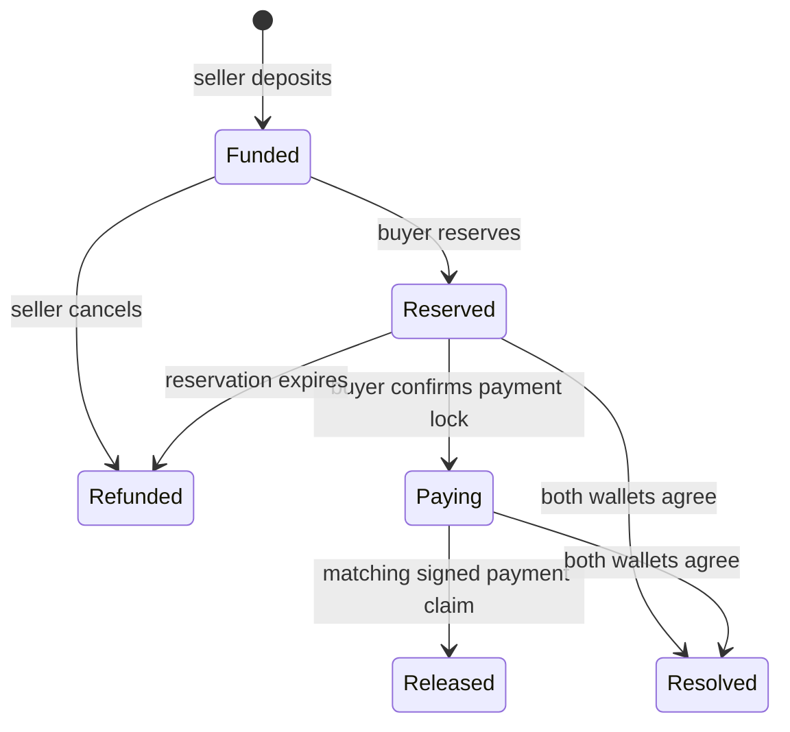

# The escrow lifecycle

One offer holds one token amount for one EUR price. A buyer takes the whole offer.

`fund` transfers the seller’s tokens into escrow. `reserve` names the buyer. `begin_payment` removes the reservation’s timeout-refund path before money is sent through the bank.

`release` checks the policy signature, stored order terms, payment time, claim expiry and unused nullifier. State change, payment consumption and token transfer happen atomically. Failed token transfers roll back the operation.

`resolve` requires both wallets to approve the same allocation. It can release everything, return everything or split the amount. The remainder always returns to the recorded seller. A policy signer cannot use this method as an administrative withdrawal.

Orders and payment markers use persistent storage. Operations must renew and restore archived entries so an old payment never appears unused because its storage expired.

The immutable configuration contains the token and policy public key. [Contract reference](../../contracts/escrow/README.md) documents every method; [protocol v1](../../contracts/escrow/PROTOCOL.md) defines the exact claim encoding.
