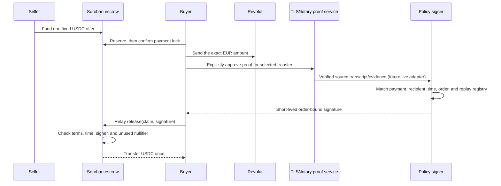

# Pactlane architecture handbook

This handbook is for explaining the system to someone who wants to understand where trust sits, what the code actually does, and what remains to prove. Pactlane's reason for existing is personal: I already have a bank account, and I would rather not hand another company a copy of my passport just to get USDC. The goal is to let two people trade directly, while revealing only the payment facts needed for that trade. That goal does not make the current prototype private end to end: Revolut sees its customers, the counterparty sees payment information, and Stellar activity is public.

Pactlane is a fixed-offer EUR/Revolut-to-USDC escrow prototype. The public app is synthetic. A separate local rehearsal joins synthetic payment evidence, the policy code, canonical signing, and the compiled Soroban contract. On 25 October 2026, a disposable testnet rehearsal passed release, replay rejection, and mutual recovery using the reviewed WASM and a synthetic PLTEST token. This does not validate an authenticated bank payment or real USDC. Treat every description below with that boundary in mind.

## Start here

- [Standalone architecture study](study.html) — an illustrated, phone-readable walkthrough with inline diagrams and the current evidence boundary.
- [System map and trust boundaries](system-map.md) — components, data flow, and where each assertion comes from.
- [Escrow contract and lifecycle](escrow-contract.md) — storage, states, callers, deadlines, token movement, and recovery.
- [Policy, signatures, and replay protection](policy-and-claims.md) — the frozen XDR protocol, recipient commitment, payment nullifier, durable issuance registry, and [future ZK upgrade](policy-and-claims.md#future-zk-verified-settlement).
- [TLSNotary and payment evidence](tlsnotary-evidence.md) — what MPC-TLS proves, what an operator still decides, and why the live adapter is blocked.
- [Privacy, authentication, and data handling](privacy-and-data.md) — visible data, private data, authentication boundaries, and logging risks.
- [Operations, diagnostics, and readiness](operations-and-readiness.md) — host services, evidence matrix, common failure interpretation, and what is still needed.
- [Explaining Pactlane](talk-tracks.md) — judge questions and 30-second, two-minute, and technical versions of the story.

## One trade, in plain terms

The diagram is the intended live payment path. The public app simulates it. The local WASM rehearsal uses synthetic evidence, and the separate testnet rehearsal used synthetic payment authorization with PLTEST. No authenticated Revolut payment was made or accepted.

## The example amount

The prototype's fixed example is €20 for 22 USDC. The offer stores EUR as `fiat_minor = 2000` (cents) and seven-decimal USDC as `token_amount = 220000000` atoms. These are synthetic demonstration values, not observed bank activity or a real quote. Fees, price discovery, and production economics are not established.

## Current claim boundary

Pactlane is not “trustless” and is not “fully ZK.” TLSNotary's transcript authentication can support a verifier's assessment of source statements; the policy operator still maps those statements to a payment decision and controls a signing key. The contract checks a signature from that configured key; it does not verify the TLS transcript or bank semantics. The public UI uses synthetic data. No KYC-free service, anonymity, privacy from the bank/counterparty, or production suitability has been demonstrated.
