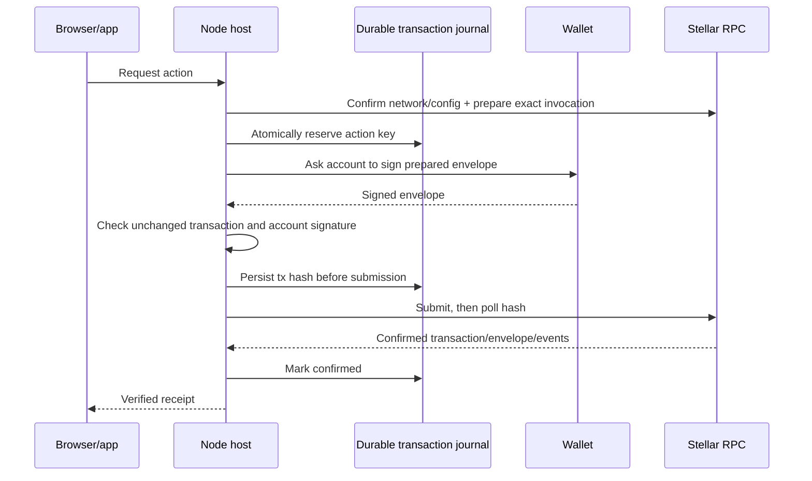

# Operations, diagnostics, and readiness

This document separates present evidence from future integration requirements. “Implemented” means source code exists; “tested locally” means a reported local test or rehearsal passed; neither means deployed or live.

## Host and transaction operations

The Node host and browser workbench are implemented in source. The host uses explicit testnet deployment configuration, HTTPS RPC, contract/token addresses, seven token decimals, the policy signer public key, and a fee cap. Network submission defaults off and must be explicitly enabled. The adapter checks the network and contract configuration, prepares a transaction, verifies the wallet returned the same transaction with the expected account signature, journals the transaction hash before submission, and checks the confirmed transaction envelope and token transfer events.

Unknown submissions remain blocked across reload/restart and are reconciled by their journaled hash. A journal row is only a retry guard, not chain proof. Confirmed receipts require the exact network, contract, transaction, order, terminal state, and matching token event totals. Adapter and host tests use wallet/RPC/service fixtures. The separate disposable testnet rehearsal passed on 25 October 2026: one synthetic release paid 220,000,000 PLTEST atoms, replay was rejected, and a second order resolved with 110,000,000 atoms to each party. It deployed the reviewed WASM and used programmatic disposable wallet keys, not Freighter UI. See the [captured rehearsal record](../../evidence/release/testnet-rehearsal-2026-10-25.json).

The adapter's `resolve()` collects the seller's Soroban authorization signature and the buyer's exact transaction-envelope signature. It simulates and checks the precise invocation and rejects unexpected authorization entries. Local fixtures cover supported simulation shapes, and the disposable testnet rehearsal confirmed the second order's mutual half split after the auth-entry serialization fix. The run does not establish Freighter UI behavior or production wallet integration.

## Diagnostic interpretation

| Observation                             | It demonstrates                                             | It does not demonstrate                                                                      |
| --------------------------------------- | ----------------------------------------------------------- | -------------------------------------------------------------------------------------------- |
| MPC setup completes                     | Prover/verifier transport setup works for that run          | Bank login, payment semantics, authenticated transfer, or release authorization              |
| Public `GET /robots.txt` proof accepted | Public-origin proof behavior for a response                 | Authenticated account or payment data                                                        |
| Response-shape-only check               | A constrained response can be observed in a diagnostic mode | Stable identities, amount units, completed outgoing transfer, or policy eligibility          |
| UI reports proof complete               | A callback reached the UI                                   | Trusted policy approval or chain settlement                                                  |
| Policy returns a signed claim           | Policy implementation and signer issued a claim             | Chain acceptance unless verified on chain; correctness still depends on adapters/operator    |
| `release` call simulated locally        | Contract invocation behavior in local execution             | Network deployment or finality                                                               |
| Local compiled-WASM rehearsal passes    | Synthetic app→policy→claim→WASM payout/replay path works    | Real bank evidence, real token transfer, testnet settlement, or public availability          |
| RPC receipt has success status          | Transaction response reports success                        | Correct user-facing receipt until envelope, order and token events are independently matched |

## Evidence matrix

| Area                  | Implemented / observed                                                                                                                           | Proven here                                                                                                                                                                      | Still unproven / excluded                                                                                               |
| --------------------- | ------------------------------------------------------------------------------------------------------------------------------------------------ | -------------------------------------------------------------------------------------------------------------------------------------------------------------------------------- | ----------------------------------------------------------------------------------------------------------------------- |
| Public app            | Synthetic browser flow and static build                                                                                                          | Local UI and model/adapter checks                                                                                                                                                | Live wallet, proof, payment, contract, and public app reachability for this lane                                        |
| Escrow                | Soroban Rust source and optimized WASM artifact; disposable testnet deployment of reviewed WASM                                                  | 29 native and same 29 compiled-WASM tests reported; local synthetic release/replay checks; testnet release and mutual recovery receipts captured                                 | Production deployment/configuration, real USDC, real funds                                                              |
| Protocol              | Frozen v1 XDR and synthetic public vectors                                                                                                       | SDK/Rust cross-compatibility and signature path in local tests                                                                                                                   | Bank-field semantics or real source identities                                                                          |
| Policy                | Order/time/recipient checks, signer adapter, durable replay/recovery registry                                                                    | 55 local policy tests reported; synthetic issuance and replay/restart behaviors                                                                                                  | Accepted TLSNotary live normalizer; authenticated transfer                                                              |
| Proof stack           | TLSNotary extension/verifier diagnostics and benchmark gateway; pinned source privacy patch                                                      | Historical public GET/setup observations; source hash confirms transcript formatter removal and Proxy rejection; offline Rust cargo check passed for the patched verifier source | Release/deployment and running-service log behavior; authenticated payment accepted by policy                           |
| Host/browser          | Capability-protected same-origin API, static testnet workbench, wallet bridge, private offer reader, policy routes, deployment verifier, indexer | Local host/indexer/policy-port tests and fixtures                                                                                                                                | Production identity/auth design, live verifier adapter, production operation, complete recovery reconciliation          |
| Wallet/RPC            | Testnet adapter, config checks, journal, receipt checks, two-party recovery signature collector                                                  | Local fixture coverage; testnet release, replay rejection, and mutual half-split recovery confirmed with programmatic disposable keys                                            | Freighter UI behavior, production wallet operation, authenticated bank payment; no real bank values or PII were used    |
| Integrated settlement | App model + policy + canonical signature + compiled contract WASM; separate testnet workbench flow                                               | Local synthetic payout and replay rejection; testnet synthetic PLTEST release and recovery receipts captured                                                                     | Authenticated Revolut payment, real USDC settlement, production service operation; no real bank values or PII were used |

## Remaining live requirements

1. Establish accepted verified evidence fields, exact units, source-account binding, recipient identity and transfer-ID stability with the proof owner. Implement and review the live normalizer against that evidence; keep missing identity as a hard block.
2. Build/deploy the source-only verifier privacy patch in the authorized environment and inspect running-service logging before making a live privacy claim.
3. Connect the host's private offer, policy, chain/indexer, wallet, and browser services to accepted live adapters and verify the host security model. Source code exists; operational configuration and validation remain.
4. The disposable testnet rehearsal is complete for its synthetic scope; retain the captured receipts and limitations. Do not broaden its result into Freighter UI validation, authenticated payment evidence, or real USDC settlement.
5. Establish accepted authenticated payment evidence and field semantics before enabling live policy signing. Keep the release gate closed until evidence and network checks both pass.

Until all required prerequisites pass, keep the release gate `NOT_CLEARED`. The prototype does not validate production bank authentication, real bank semantics, real fiat settlement, real-token custody, production deployment, or any user KYC outcome.
