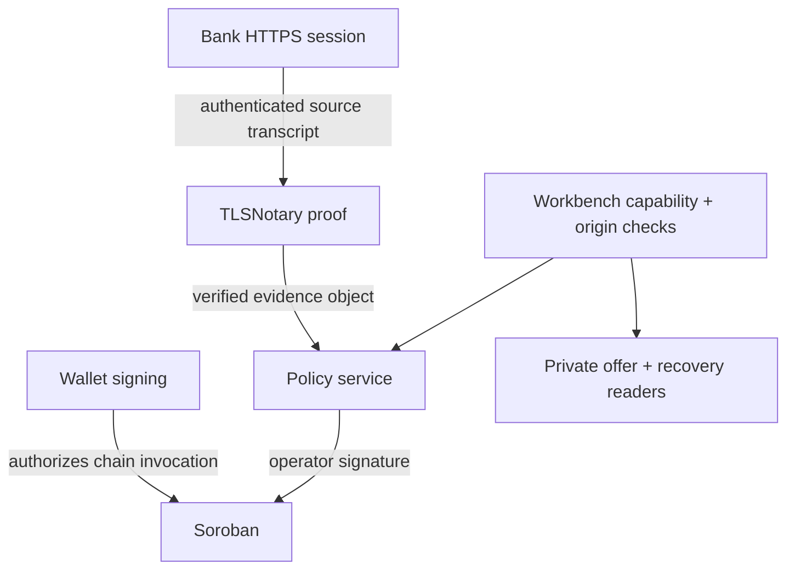

# Privacy, authentication, and data handling

The privacy goal is data minimization: avoid collecting a second copy of a person's identity documents when the trade needs evidence that a particular payment happened. That is a design goal, not a claim that Pactlane makes a transaction anonymous or private from all participants.

## Who can see what

| Data                                                              | Expected visibility                                                                                   | Current caveat                                                                                                                                                                                                                                                   |
| ----------------------------------------------------------------- | ----------------------------------------------------------------------------------------------------- | ---------------------------------------------------------------------------------------------------------------------------------------------------------------------------------------------------------------------------------------------------------------- |
| Legal identity and account activity                               | Revolut and any party to whom the user pays or discloses it                                           | Pactlane cannot hide it from the bank or payment recipient.                                                                                                                                                                                                      |
| TLS transcript and selected fields                                | Prover/verifier components as required by the proof and disclosure flow                               | A reviewed source-only patch removes transcript formatting from verifier logs and refuses Proxy commitment mode. Patched source passed offline Rust `cargo check`; it has not been released or deployed, so running-service logging behavior remains unresolved. |
| Recipient identifier and per-offer salt                           | Seller's authorized private offer-data store and policy process                                       | The host has a private offer reader in source. Neither value belongs on chain or in public app payloads; operational access still needs review.                                                                                                                  |
| Payer scope/payment ID                                            | Trusted verifier/evidence adapter and policy replay registry                                          | The nullifier derived from them is stable pseudonymous data, not anonymous data.                                                                                                                                                                                 |
| Commitment and nullifier                                          | Public chain claim/order or used-nullifier state                                                      | Hashes can still be linkable; salt reuse and external context matter.                                                                                                                                                                                            |
| Order terms, wallet addresses, state, timestamps, token movements | Public Stellar ledger                                                                                 | Wallets and settlement are not private.                                                                                                                                                                                                                          |
| Policy signature and digest                                       | Caller, RPC, and public chain                                                                         | Signature reveals an authorization, not the raw transcript, but is attributable to the order.                                                                                                                                                                    |
| Host access capability and bank credentials                       | Capability is held by the workbench browser; bank credentials remain with the bank/browser proof flow | The test workbench has bearer-capability and same-origin checks in source. This authenticates API access to that host, not a person's legal identity or a production user account. Never commit capabilities or credentials.                                     |

## Authentication is layered

Wallet authentication proves control of a Stellar account for a particular invocation. TLSNotary authenticates a TLS transcript with the bank origin. The test workbench has a same-origin HTTP client, bearer capability, wallet bridge, private offer reader, and policy/chain service routes in source. This is a capability-gated development workbench, not production user identity or proof that a remote host is securely operated. A browser callback or “proof complete” event is only progress UI; trusted policy status and final chain confirmation must be read separately.

The policy signer is an operator credential, not a user credential. The app must not supply the key. Current integration code supports a host-side signing adapter, and host config code can load a restricted local key file, but no production signer deployment or security review is established.

## Data-flow handling rules reflected in code

- Caller boundary accepts only order/evidence identifiers for issuance; evidence, order, recipient salt, and chain data come from trusted adapters.
- Bank identities and salt are absent from contract order storage; the contract stores only a 32-byte recipient commitment.
- Policy replay data is server-side SQLite and retained without automatic expiry. Files are created with restrictive permissions.
- The transaction journal stores action key, state, transaction hash, and method. It does not store wallet secrets or signed envelopes. Preparing or unknown actions cannot auto-expire.
- Public app build is a static allowlisted set with no external connections under its default security headers. Its synthetic fixtures are not live account data.
- The source-only TLSNotary privacy patch addresses transcript formatting and Proxy-mode admission in the pinned verifier source and passed offline Rust `cargo check`. Build/release/deploy behavior and running-service logs still need independent verification before live use.

## Recovery has a privacy and safety cost

Mutual `resolve` does not require policy proof and pays a chosen token split only when both wallets authorize the exact invocation. It also does not identify which fiat transfers occurred. Therefore off-chain reconciliation must associate a confirmed recovery with a complete verified payment manifest and consume all associated nullifiers. Without that identity, the system must hold signing rather than risk reusing a payment. This is a deliberate safety dependency, but it means recovery requires trusted records and may retain sensitive pseudonymous payment metadata.
