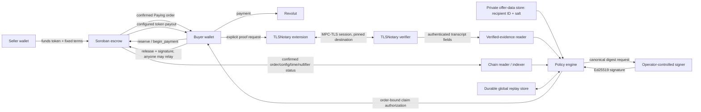
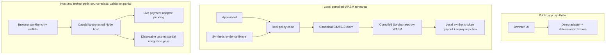

# System map and trust boundaries

## Components and authority

| Component                   | What it does                                                                                                                                    | What it can establish                                                                                                                                                                            |
| --------------------------- | ----------------------------------------------------------------------------------------------------------------------------------------------- | ------------------------------------------------------------------------------------------------------------------------------------------------------------------------------------------------ |
| Browser app                 | Shows offers and guides a buyer/seller through actions. Current public app uses a synthetic adapter.                                            | UI state only. A progress callback is never payment authorization.                                                                                                                               |
| Wallet                      | Authenticates Stellar actions and signs the transaction envelope for its account.                                                               | The wallet owner authorized that exact transaction; not that fiat arrived.                                                                                                                       |
| Soroban escrow              | Holds the configured token, tracks one-offer/one-buyer orders, validates policy signatures and moves tokens.                                    | Contract invariants and execution on the selected network. It does not validate a bank transfer.                                                                                                 |
| TLSNotary client + verifier | Runs an MPC-TLS proof against a pinned source and authenticates a disclosed TLS transcript.                                                     | That disclosed bytes belong to the authenticated server session under the protocol assumptions. It does not decide whether a payment qualifies.                                                  |
| Payment policy              | Reads verified evidence, trusted order state, private offer data, and replay state; checks business rules and requests a signature.             | An operator-approved claim, based on its adapters and controls. This trust is material.                                                                                                          |
| Policy signer               | Holds the Ed25519 signing capability configured in the contract.                                                                                | Contract-accepted authorization for claims within contract checks. A compromised signer can sign incorrect semantics.                                                                            |
| Host/RPC service            | Node host source for the testnet workbench, capability-protected API, wallet bridge, chain reads/submission, transaction journal, and receipts. | Code checks transaction identity and confirmation; fixtures cover service behavior. A disposable testnet rehearsal passed release, replay rejection, and mutual recovery using synthetic PLTEST. |
| Durable stores/indexer      | Track payment issuance/nullifiers, unresolved recovery, transaction attempts, and chain checkpoints.                                            | Replay and recovery safety only if durable, complete, correctly operated, and reconciled.                                                                                                        |

## Data path and trust edges

The evidence-reader, policy, signer, and private-offer links are server-side trust edges. Client-supplied amounts, “verified” flags, order snapshots, claims, or digests must not cross those boundaries as authoritative values. The policy entry point currently takes only `{orderId, evidenceId}` and uses injected trusted readers.

## Two distinct proof layers

1. **Source transcript layer:** TLSNotary cryptography links the selected disclosure to an authenticated TLS session with the configured origin. The gateway pins destinations and constrains routes; those checks reduce routing mistakes but are not a payment judgment.
2. **Settlement authorization layer:** policy interprets the source fields against the chain order, timestamps, recipient commitment, and replay state, then signs a canonical claim. The Soroban contract verifies that signature and its own invariants.

The contract never sees the transcript or TLSNotary proof. It trusts the Ed25519 key in immutable constructor configuration. A policy defect, dishonest operator, or key compromise can therefore produce a bad claim that still passes signature verification if it also satisfies the contract's order/time limits.

## Demo, rehearsal, and intended live system

Do not merge these three paths in a description. The synthetic compiled-WASM rehearsal is local and submits no network transaction. A separate disposable testnet run passed one synthetic release, replay rejection, and one mutually authorized split recovery. It used PLTEST, not USDC, and no bank proof. It validates selected integration mechanics, not the authenticated payment path.
