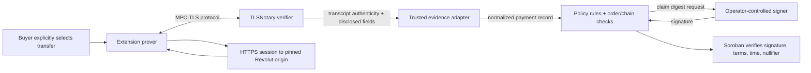

# TLSNotary and payment evidence

TLSNotary is the evidence transport and transcript-authentication layer. It uses MPC-TLS between a prover and verifier so the verifier can check a server response while the prover selectively discloses transcript data. Pactlane's policy then has to decide what those authenticated bytes mean for a particular order. Cryptographic transcript authenticity is not the same thing as a correct payment decision.

## Proof and decision boundary

The verifier authenticates the session transcript under the TLSNotary protocol and its deployed code/configuration. It does not independently guarantee that an adapter chose the correct account, payment, amount unit, direction, recipient identity, or completion status. The policy owner must establish those semantics from a real accepted response schema and bind all readers to the right evidence object.

The on-chain contract never receives the full transcript or verifies TLSNotary cryptography. It trusts one Ed25519 public key fixed at construction. The operator's signature says “this policy accepted this order-bound payment claim”; it does not mean the chain validated the bank itself.

## What currently runs

- Extension setup and public-response diagnostics test MPC setup and fixed public GET behavior. Those checks use no bank credentials and do not prove a payment.
- Response-shape checks can inspect limited response shape but do not establish usable stable payer/recipient/payment identities.
- The earlier TLSNotary launcher is a diagnostic gateway, not authenticated Pactlane production transport.
- The benchmark stack uses operator-pinned verifier origins, constrained routes, origin checks, and bounded admission/resource controls. These are routing and availability controls, not bank authentication, user authentication, or a payment policy.
- A reviewed source-only verifier patch now removes formatting of transcript bytes from verifier logs and rejects Proxy commitment mode before it connects to the target, while leaving the MPC path intact. This is a local-source change with pinned source and patch hashes; no build, restart, deployment, or live privacy verification has been performed. It does not establish that any currently running verifier has stopped logging disclosed bytes.
- In the current integration, `normalizeLiveTlsnPayment` always fails closed. The TLSNotary plugin is not yet adapted to live policy issuance.

## Evidence required before live signing

The verified server evidence must establish a stable provider-issued recipient ID, stable source-account scope, stable transfer ID, exact amount and units, currency, direction, transfer type, completion state, and completion timestamp. It must also establish authenticated account/session binding and show that retries or alternate representations map to the same identity. A client-supplied identifier, display name, URL parameter, cookie, screenshot, or expected order value cannot fill an evidence gap.

The frozen protocol fixes identity encodings once real canonical source values are established. It does not claim that the current proof system has produced those values. If identity availability or units are missing, signing must remain blocked and the order stays held.

## Operator trust and failure cases

The operator can choose evidence mapping, policy implementation, deployment configuration, and signer key custody. A bad mapping or compromised signer could authorize an incorrect claim; the contract prevents mismatched terms, invalid timestamps, reused nullifiers, and wrong signer signatures, but it cannot catch every false assertion about off-chain payment semantics. Key management, independent review, auditability, and incident response remain production design requirements.

A proof failure after `begin_payment` does not refund automatically. The order remains held for a later valid claim or mutual recovery. This avoids a seller taking escrow back after a buyer may have paid, but it can leave both parties stuck if evidence never becomes usable or one party stops cooperating.
